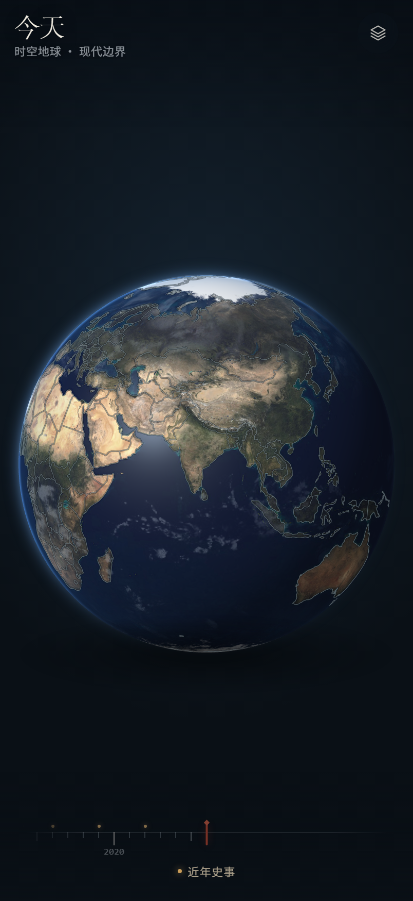

# Spacetime Globe · 时空地球

一本可以通过时间和空间进入历史现场的世界历史书。

[在线体验](https://lllliam.github.io/spacetime-globe/) · [下载单文件离线版](https://lllliam.github.io/spacetime-globe/index.offline.html)（保存 HTML 后用浏览器打开）

<a id="操作"></a>

## 可以体验什么

- 转动、缩放地球，用底部时间轴或左上角年份输入定位历史，点选疆域查看主体摘要。
- 从摘要进入历史书卷，用目录切换章节、查看段落出处。只有地图资料的主体可查看覆盖年代和来源。
- 从正文打开历史场景，观察地点、路线和时间阶段，再返回原章继续阅读。

| 探索地球 | 阅读书卷 |
| --- | --- |
|  |  |

以上为 v14.2.1 原型实拍。[历史截图档案](docs/archive/screenshots/README.md)

## 开发状态

现有体验来自 v14.2.1 原型部署。本地基线为 [cfac746](https://github.com/lllliam/spacetime-globe/commit/cfac7462bcd232d50baecd795962c8cd74af2597)，包含 57 卷、228 章、48 个历史地球场景，以及 28 组、117 篇补充专题。覆盖和审校范围见[内容覆盖](docs/CONTENT-COVERAGE.md)与[来源核查](docs/SOURCE-AUDIT.md)。

`develop/1.0` 已完成 Phase 06。读者可从正文主动进入历史现场，按阶段观察地点与有依据的空间联系，再返回原文。书卷按共时、比较、历史联系及背景组织延伸阅读。[历史现场](docs/HISTORICAL-SCENES.md) · [阶段报告与实拍](docs/progress/PHASE-06.md) · [开发路线](docs/ROADMAP.md) · [历史内容模型](docs/HISTORY-MODEL.md) · [状态模型](docs/STATE-MODEL.md)

正式版 `1.0.0` 在最终验收通过后发布。

<a id="版本记录"></a>

[原型完整版本记录](docs/archive/CHANGELOG-PROTOTYPE.md)

## 开发与构建

使用 Node.js 22 或更新版本。界面在 `src/`，编辑源文件在 `data/books/`、`data/topics/` 和 `data/scenes.json`。在线和离线 HTML 均由构建生成。

```sh
node tools/verify-content.mjs
node build.mjs
node tools/serve.mjs
```

打开本地服务地址体验在线构建，或直接打开 `index.offline.html`。浏览器回归使用 `npm run verify`、`npm run verify:mobile`、`npm run smoke`、`node tools/verify-home.js` 和 `node tools/verify-reading.js`，依赖 Chromium 或 Edge。给首页或阅读专项传入输出目录即可保存实拍。会话回归使用 `node tools/verify-session-state.mjs` 和 `node tools/verify-session-browser.js`。验证脚本和构建会写出生成文件，文档阶段在临时副本运行。

历史模型专项使用 `node tools/verify-history-model.mjs`。同源旧会话迁移使用 `node tools/verify-history-browser.js <Phase-04 生成的 index.html> [实拍输出目录]`，基线和复核命令见 [Phase 05 报告](docs/progress/PHASE-05.md)。

场景及关联验证使用 `node tools/verify-observation-model.mjs` 和 `node tools/verify-observation.js [实拍输出目录]`。源数据比对使用 `node tools/audit-observation.mjs <Phase 05 目录> [报告文件]`。[阶段报告](docs/progress/PHASE-06.md)

[产品规范](docs/PRODUCT-SPEC.md) · [工程架构](docs/ARCHITECTURE.md) · [设计实现](docs/DESIGN.md) · [内容编辑](docs/READING.md) · [最终验收](docs/ACCEPTANCE.md) · [版本规则](docs/VERSIONING.md) · [维护约定](AGENTS.md) · [原型历史档案](docs/archive/README.md)

## 数据来源与许可

- 历史疆域来自 Seshat Global History Databank 的 Cliopatria（CC BY 4.0，公元前 3400 年至 2024 年）。该资料集由 Ed Chalstrey、James Bennett、Erin Mutch 等编辑整理。工程将原有几何重编码为球面绘制与拾取使用的数据包，并提供中文标签。[资料集](https://github.com/Seshat-Global-History-Databank/cliopatria) · [资料集署名](https://zenodo.org/records/13363121) · [许可](https://creativecommons.org/licenses/by/4.0/)
- 现代国界及地形海陆遮罩来自 Natural Earth，数据处于公有领域。[使用条款](https://www.naturalearthdata.com/about/terms-of-use/)
- 基础地表和云层来自 three.js r160 地球示例。高清地表使用 NASA Goddard Space Flight Center 的 Blue Marble（Reto Stöckli 等）缩制并校色。[示例纹理](https://github.com/mrdoob/three.js/tree/r160/examples/textures/planets) · [Blue Marble](https://science.nasa.gov/earth/earth-observatory/the-blue-marble-true-color-global-imagery-at-1km-resolution/) · [NASA 媒体指引](https://www.nasa.gov/nasa-brand-center/images-and-media/)
- 4K 地形法线由 GMT 的 5 弧分高程网格（本次资产记录为 SRTM15+ v2.5.5，Tozer 等）结合 Natural Earth 陆地和湖泊数据生成。[生成工具](tools/build-terrain.py) · [GMT 数据说明](https://www.generic-mapping-tools.org/remote-datasets/earth-relief.html) · [SRTM15+ 数据记录](https://portal.opentopography.org/datasetMetadata?otCollectionID=OT.122019.4326.1)
- 正文出处按篇或段落随文给出。本仓库的代码、正文和未单独标明的资产没有统一的仓库许可证，第三方资料应查阅各自署名与条款。
