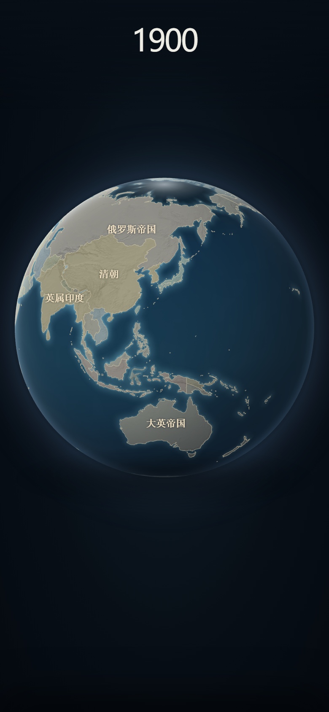

# 地球仪 · 时空坐标

**一本可以进入历史现场的世界历史书。** 转动地球、选一个年份、点开一个历史主体，就能沿着它的一生往下读，并回到故事发生的地方观察。

[在线体验](https://lllliam.github.io/spacetime-globe/) · [单文件离线版](https://lllliam.github.io/spacetime-globe/index.offline.html) · [内容覆盖](docs/CONTENT-COVERAGE.md)



## 设计理念

**历史叙事是主线，地球是历史发生的舞台。** 地球帮助读者发现一段历史，正文解释其中的前因后果，历史场景再把值得观察的空间关系带到同一个地球上。探索、阅读、观察构成一条连续的路径。

- **探索。** 年份和地点用来定位历史主体。1500 年或 1600 年点击明朝疆域，都会进入《明朝》全卷，目录只用入口年份提示所在章节。
- **阅读。** 正文始终由读者掌控。场景入口跟着相关段落出现，由读者决定是否打开。目录、出处和延伸阅读可按需查阅。
- **观察。** 地球按场景年份呈现地点角色、空间关系及可用的历史疆域。返回正文恢复原章和阅读位置，探索时选定的年份与镜头也会保留。当前版本为每个场景设定一个观察年份。

历史场景有稳定身份，可被多章、多卷引用。一章也可以在不同段落引用多个场景。每次从正文进入地球，读者应能看清一个仅凭文字较难理解的空间关系，例如一座都城如何依赖远方的供给。地点、路线和其他空间信息以资料所能支持的范围为准。

- **主体明确。** 首页以地球为视觉中心。阅读以国家、王朝和帝国等历史主体为单位，通过固定的书卷身份组织内容。地图上重叠的主体可在阅读中按需查阅。
- **叙事优先。** 一卷串起建立、发展、转折、结局与影响。每章围绕一个历史问题展开，交代前因与后果。仍存续的主体继续增订。
- **关联按需。** 事件、人物、地点、其他政权和来源帮助读懂当前章节。各类关联顺着正文展开。
- **渐进深入。** 地球用来探索，半窗用来快速了解，正文用来建立理解，出处支撑进一步查证。只有地图资料的主体会如实标明收录状态，完整书卷由编辑选材和核对。

## 内容

中文版现有 **15 卷、65 章**。新收录《汉朝》《唐朝》《德川幕府》《高棉帝国》《莫卧儿帝国》《阿契美尼德帝国》《马里帝国》《桑海帝国》《阿兹特克帝国》和《印加帝国》。原有 28 组、117 篇专题可在历史书目的「补充专题资料」中查阅。 [完整书目与覆盖范围](docs/CONTENT-COVERAGE.md)

《明朝》全卷已重写。从元末的长江争夺写到洪武建制、永乐迁都、边防和江南市场、晚明财政与战争，再读到南明、郑氏与明清之间的制度接续。正文已接入 **15 个历史场景**，其中《明朝》有四处，分别观察靖难、两京之间的漕运、壬辰战争中的朝鲜半岛，以及 1644 年北京如何易手。

书卷以中文撰写，段落可直接跳到对应出处。根据史料约定，以「约」或「传统分期」标出的年代用于定位章节。历史地图统一使用简体中文名称，有常用译名的采用常用名，其余采用音译或描述性译名。待考名称可在地图资料中按需展开底图原名。

## 操作

- 单击年份查看当年的具体事件，长期背景可按需展开。「读《书名》」直达对应章节，返回后接着浏览原来的列表。
- 点年份条目的标题可在地球上查看已知地点或相关地区。点地名了解其在事件中的作用，展开参与方可查看各方角色。
- 长按年份可在原位左右拨动，双击可输入年份或「今天」。键盘支持 Shift+Enter 展开、方向键逐年调整和 F2 输入。
- 长按地球打开底部视图面板，即时预览「随年份」「现代边界」或「地形」。下拖上沿收起，桌面支持右键或 Shift+F10。
- 拖动旋转，双指缩放和平移。轻点疆域查看该主体的摘要，上拉或点「打开全卷」进入目录。正文中的「在地球上看」打开对应场景，轻点地点可查看它的作用，左上角返回正文。从正文顶部下拉可回到原半窗。

历史疆域来自 Cliopatria，覆盖公元前 3400 年至 2024 年。现代国界来自 Natural Earth，海岸与地形采用现代底图。正文各篇列有来源。

## 版本记录

| 版本 | 主要变化 |
| --- | --- |
| **6.1.0** | 重写《明朝》全卷，逐段标注来源。四处历史场景分别说明都城、漕运、半岛与关口的地理关系。 |
| [6.0.0](https://github.com/lllliam/spacetime-globe/tree/7a5bbd9) | 历史场景成为正文和地球的共同入口。场景紧跟相关段落，读者可主动观察并返回原处。 |
| [5.2.0](https://github.com/lllliam/spacetime-globe/tree/7b9bf1b) | 重做地球视图面板。年份入口以具体事件引导阅读，长期背景按需展开，已关联的条目直达书卷。 |
| [5.1.0](https://github.com/lllliam/spacetime-globe/tree/13637d2) | 新增 10 卷、40 章，扩充西亚、西非、美洲与亚洲的历史叙事。统一历史地图、主体摘要和世界表的中文名称。 |
| [5.0.1](https://github.com/lllliam/spacetime-globe/tree/b896c7e) | 地球按前台实际画布尺寸重绘，为 iPhone 主屏幕启动时的缩短视口做边缘过渡。地名避开年份。 |
| [5.0.0](https://github.com/lllliam/spacetime-globe/tree/50fff85) | 地球和年份定位历史主体，同一主体进入同一卷书。首批 5 卷，支持目录年份定位、连续阅读与地图往返。 |
| [4.7.1](https://github.com/lllliam/spacetime-globe/tree/ca3da37) | 统一加载页与屏幕边缘的底色，收起的半窗停止绘制。收紧横拨的年份间距。 |
| [4.7.0](https://github.com/lllliam/spacetime-globe/tree/a87b344) | 长按年份原位横拨，大幅拖动加速，停稳后切换疆域。单击看世界表，双击就地输入年份。 |
| [4.6.0](https://github.com/lllliam/spacetime-globe/tree/8f4db7c) | 从年份事件表进入地球事件视图，点地名了解地点，展开查看各方角色。首批以 1900 年义和团危机和 1842 年《南京条约》呈现。 |
| [4.5.4](https://github.com/lllliam/spacetime-globe/tree/0a37771) | 地球上显示同一事件的地点关系，可点地点查看它在事件中的作用。首批覆盖天津到北京、南京与五处通商口岸。 |
| [4.5.3](https://github.com/lllliam/spacetime-globe/tree/f183a9a) | 详情先讲事件，地点、背景和出处顺着正文展开。晚清八篇更新开篇。 |
| [4.5.2](https://github.com/lllliam/spacetime-globe/tree/150ddd8) | 阅读支持从左边缘右划返回、在正文顶部下拉收起。地区年表按时间排成一条路线。 |
| [4.5.1](https://github.com/lllliam/spacetime-globe/tree/fb6256c) | 摘要和阅读共用抽屉，下拉时连续过渡。地点预览在地球上标出具体地点，保留原文阅读位置。 |
| [4.5](https://github.com/lllliam/spacetime-globe/tree/2ddcb08) | 重做半窗与阅读界面。年表分开显示事件和时代背景，更新中国现代年表。 |
| [4.4.2](https://github.com/lllliam/spacetime-globe/tree/b2e2723) | 修复放大后云层出现多边形缺口的问题。 |
| [4.4.1](https://github.com/lllliam/spacetime-globe/tree/03aeafd) | 修复太平洋方向的竖向贴图接缝。 |
| [4.4](https://github.com/lllliam/spacetime-globe/tree/65664a8) | 云层独立于地表缓慢移动，加入云影与受光方向一致的大气渐变，改进日夜交界。 |
| [4.3](https://github.com/lllliam/spacetime-globe/tree/b941635) | 更新真实海陆纹理、云带、日夜光照与大气薄层；默认隐藏地名以突出地球，放大后显示。移除首页底部文字，统一安全区背景。 |
| [4.2](https://github.com/lllliam/spacetime-globe/tree/35ea64c) | 按 iPhone 17 Pro 竖屏比例调整首页，加入年份对应的阅读入口、默认自转与双指平移回弹。 |
| [4.1](https://github.com/lllliam/spacetime-globe/tree/e5b6a5f) | 简化首页与年份字体。轻点年份打开全球事件表，长按展开渐隐时间轴。长按或右键地球打开观察选项。 |
| [4.0](https://github.com/lllliam/spacetime-globe/tree/1a83588) | 重做地球首页与球面材质，加入按需展开的时间轴、播放和自然地理视图。 |
| [3.0](https://github.com/lllliam/spacetime-globe/tree/2d7866c) | 扩展为六洲 28 组专题、117 篇正文，加入跨专题阅读、大洲筛选与逐段出处。 |
| [2.2](https://github.com/lllliam/spacetime-globe/tree/617b427) | 更新应用图标，加入半窗上拉阅读、下拖关闭和阻尼回弹。 |
| [2.1](https://github.com/lllliam/spacetime-globe/tree/0931471) | 加入独立阅读层、晚清专题和地图往返。 |
| [2.0](https://github.com/lllliam/spacetime-globe/tree/5eae8f9) | 加入历史政权图层、矢量边界与地名，以及按时期浏览的资料。 |
| 1.0 | 建立可旋转缩放的 WebGL 地球、时间轴与 Canvas 兜底。 |

版本链接指向对应的 GitHub 源码快照。需要回退发布时，从目标提交恢复到新的 Git 提交，再部署到 GitHub Pages。

## 开发

```sh
npm run content:verify
npm run build
npm run serve
npm run verify
npm run smoke
```

界面源码在 `src/`。主体书卷存于 `data/books/`，历史场景存于 `data/scenes.json`，补充专题存于 `data/topics/`。构建验证书卷、场景年代、段落锚点、地点与出处，生成 `index.html` 和 `index.offline.html`。

[产品设计](docs/DESIGN.md) · [内容编辑](docs/READING.md) · [内部架构](docs/ARCHITECTURE.md)

地球表面与云层纹理来自 [three.js r160 地球示例](https://github.com/mrdoob/three.js/blob/r160/examples/textures/planets/earth_atmos_2048.jpg)。海陆影像表示现代地理，历史疆域叠加在该底图上。
