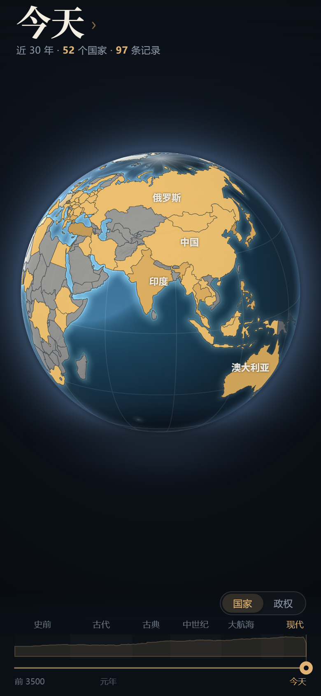
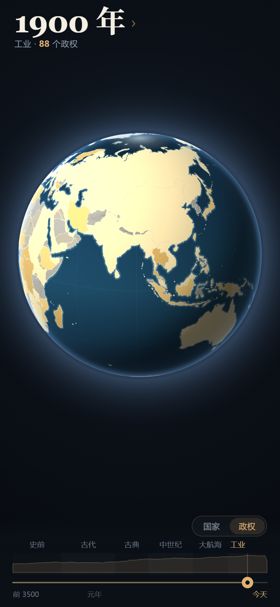
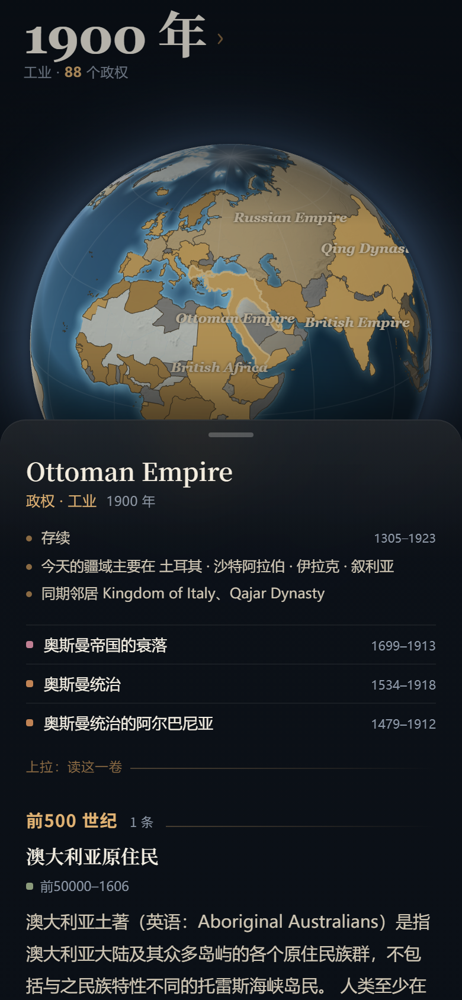
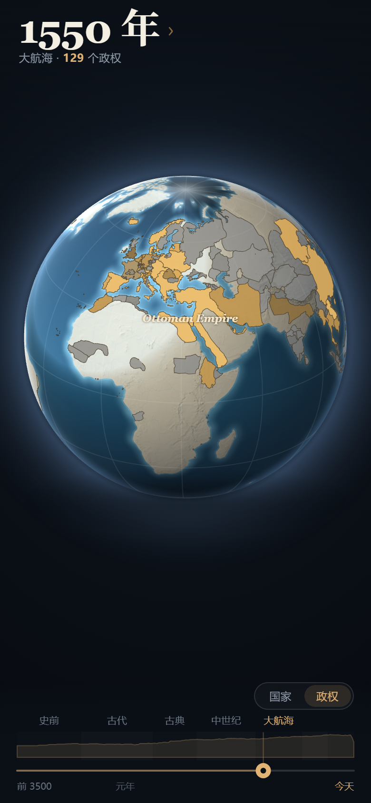

# 地球仪 · 时空坐标

一个球，一条时间轴，一个图层开关。拖动时间轴走进任何一个年代，球面上的颜色和边界跟着变：金色越深代表这一年这里的记录越多。点任意一块陆地，看它是谁、活了多久、今天变成了哪些国家、当时境内发生了什么。

- 在线：<https://lllliam.github.io/spacetime-globe/>
- 单文件离线版：下载 `index.offline.html` 双击即可（数据全内嵌，不需要服务器）
- iPhone / Android：浏览器打开 → 分享 →「添加到主屏幕」，全屏运行、断网可用






## 渲染：位图打底，矢量描边

地球是两层叠出来的，各自干各自擅长的事：

| 层 | 内容 | 为什么 |
| --- | --- | --- |
| WebGL 球体（2048×1024 贴图） | 海底深度、大陆架晕边、地形浮雕、昼夜光照、边缘大气 | 面是软的、可以糊，位图够用且便宜 |
| 2D 矢量叠加层（设备分辨率） | 国界/政权边线、经纬网、地名 | 线和字不能糊：放大 6 倍仍是 1px 锐线、字号不变 |

- 边线和经纬网**不走贴图**，而是把路径的每个顶点投到屏幕后直接画——所以放大不糊，且线宽随缩放微调。
- 地名按**投影面积**决定显不显示（1× 只显示大国，放大后逐级出现），贪心避让防重叠，避开顶部 HUD 和底部时间轴。
- 陆海分界也补了一层矢量填充（alpha 0.92），盖住位图放大后的阶梯边；贴图的地形浮雕从下面透出来。
- 经纬网随缩放加密：30° → 15° → 10°。

## 两个图层

| 图层 | 数据 | 点一块陆地看到什么 |
| --- | --- | --- |
| **国家**（默认） | 现代国界 177 块 + 1512 条年表 | 国家名、年表收录数、这一年的记录列表 |
| **政权** | Cliopatria：13,797 个时间切片 / 1,604 个政权 / 前 3400–2024 | 政权名、存续年、**今天的疆域主要在哪些国家**、**同期邻居**、**当年境内发生的条目** |

政权层没有一句现成文本，档案页的每一行都是算出来的：多边形 × 现代国界相交 → 今天的国家；pick 栅格四邻 → 同期邻居；条目代表点落点 + 时间相交 → 当年条目。这也顺带回答了一个老问题：**「这个帝国今天变成了哪些国家」不需要人工写。**

## 这一版做了什么（v2）

- **图层抽象**：`Layer = { shapes(year), entityOfShape() }`。国家层、政权层共用同一份栅格化 / 拾取 / 着色 / 邻居 / 档案代码，加第三个图层（文化圈、宗教）只写两个函数。
- **政权层跑通**：把网页版 6.4 MB 的 base64 边界包重打成自解释二进制——量化 1/4 像素 + 增量 + zigzag varint + 路径去重，**25.6 MB JSON → 4.47 MB bin → gzip 1.06 MB**；单年只解 88–192 条路径，Path2D 有 LRU 缓存。
- **首屏从 682 KB 降到 ~140 KB**：`index.html` 只有壳和代码（70 KB），数据按需取；政权层在空闲时后台预取，切图层不用等。
- **数据与代码分离**：`data/world.json`（地区 + 年表 + 国界 + 177 个中文地名）、`data/polity.bin.gz`、`data/relief.jpg`。构建同时产出单文件离线版。
- **拾取去噪**：两个 id 交界处的混色会算出第三个 id（既点错也连出假邻居），用四邻多数把 1px 杂点擦掉，再加 3×3 多数表决。
- **档案模板统一**：抬头 / 事实行 / 条目列表，国家与政权共用一个模板，加内容不改界面。
- 继承 v1.0：WebGL 球体 + 昼夜光照 + 边缘大气、空闲即停、无 WebGL 时 Canvas2D 兜底、Service Worker 网络优先。

## 数据来源

- **现代国界**：Natural Earth（公有领域）
- **历史政权疆界**：Cliopatria / Seshat Global History Databank，CC BY 4.0
- **年表**：1512 条公开记录，105 个地区分组，逐条尽量标注出处；条目代表点由所属地区国界质心算出（88% 有）
- **地形浮雕**：内嵌灰度晕渲图

## 开发

### v2.2：图标与半窗手势

新图标采用深蓝珐琅、暖金浮雕地球与刻度环，分别提供浏览器、iOS 主屏幕与 PWA 尺寸。原始母版和生成说明见 [docs/ICON.md](docs/ICON.md)。

半窗的抓手与摘要头都可拖动：上拖进入全屏阅读，下拖关闭，轻拖回弹。支持快速轻扫、阻尼弹簧、松手提示、手势取消和减少动态效果；条目区正常滚动。

### v2.1：独立阅读层

点陆地看此刻摘要 → 点击专题入口或从抓手上拉 → 阅读专题 → 打开节点详情。正文可主动定位到地图，再回到原文；最终返回地球会恢复进入前的年份与视角。阅读时隐藏时间轴，详情与概览各自保留滚动位置。

首份专题是《中国 · 1840—1912：晚清的危机与转型》，含六个节点与独立来源。其他地区按时期阅读现有年表资料。专题数据为 `data/topics.json`，阅读逻辑为 `src/reading.js`，两种构建产物均可使用。设计细节见 [docs/READING.md](docs/READING.md)。

```bash
npm run data       # 从时空坐标_v1.4.html 重打数据 → data/world.json + data/polity.bin(.gz)
npm run build      # src/ + data/ → index.html（线上）与 index.offline.html（单文件）
npm run serve      # http://localhost:8080 本地预览（必须 http，数据走 fetch）
npm run verify     # 无头浏览器回归：拾取一致性 / 两个图层 / 档案 / 时间轴（11 项）
```

源码：`src/shell.html`、`src/app.css`、`src/app.js`；数据管线：`tools/build-data.js`。
**不要直接改 `index.html`**，它是产物。

- 产品意图：[docs/DESIGN.md](docs/DESIGN.md)
- 内部架构：[docs/ARCHITECTURE.md](docs/ARCHITECTURE.md)

## 已知欠账

- 政权名只有英文（1,604 个），中文名要靠 Wikidata 补；链路已验证（`tools/enrich-pilot.js`），被 API 限流卡住，需要断点续跑
- 条目代表点用国界质心，边境地区关联会有偏差
- 图层切换没有交叉淡入；第三个图层（文化圈 / 宗教）只有接口没有数据
- 政权数据截止 2024 年，再往后的年份沿用 2024 边界并在 HUD 里注明
