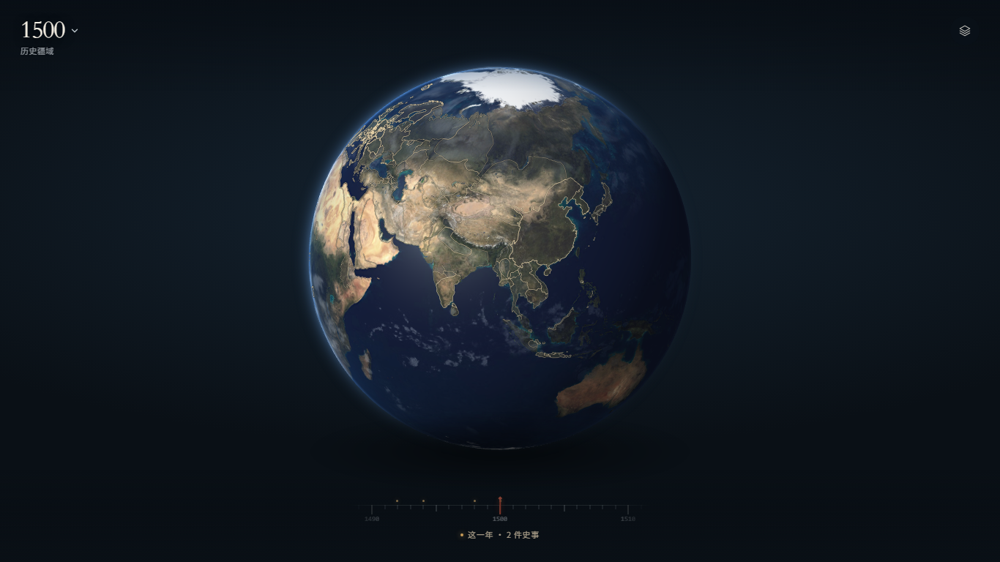
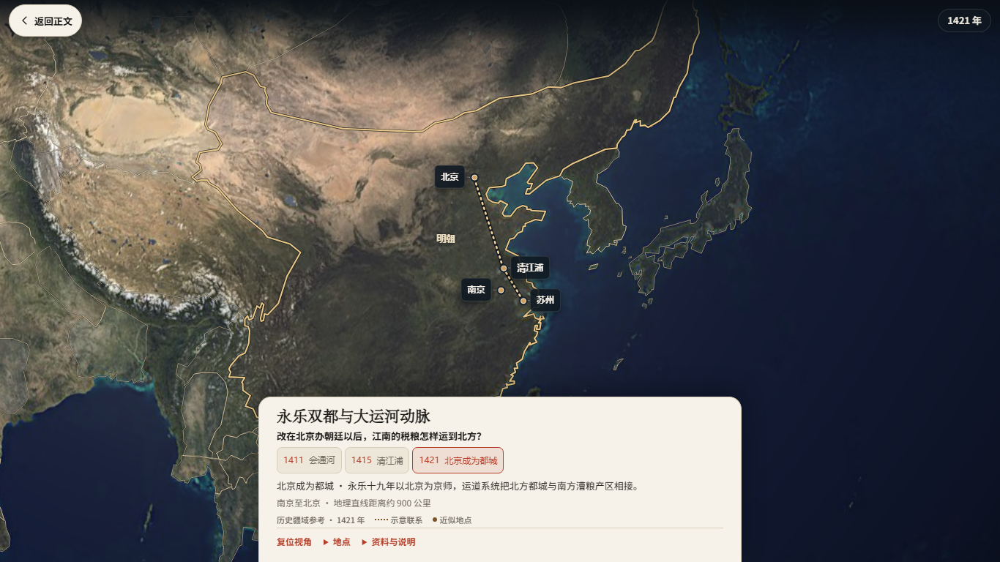

# Spacetime Globe · 时空地球

一本可以通过时间和空间进入历史现场的世界历史书。

**让历史成为一个可以亲自进入的世界。**

**History is a world you can enter.**

地球是舞台，时间是坐标，历史是主体，理解是目的。

[在线体验](https://lllliam.github.io/spacetime-globe/) · [单文件离线版](https://lllliam.github.io/spacetime-globe/index.offline.html)

<a id="操作"></a>

## 可以体验什么

- **Explore · 探索**。旋转、缩放地球，用时间轴或年份输入定位历史，点选疆域查看主体摘要和相关书卷。
- **Read · 阅读**。在全屏书卷中使用目录切换章节、阅读正文和查看出处。再次打开时可以继续阅读。
- **Observe · 观察**。从正文主动打开历史现场，查看地点、路线及时间阶段，然后返回原章。

| Explore · 探索 | Read · 阅读 | Observe · 观察 |
| --- | --- | --- |
|  |  |  |

截图采自 `1.0.0-rc.1` 的 Edge 验收构建。[工程验收报告](docs/progress/PHASE-09.md)

## 当前公开版本

`1.0.0-rc.1` 于 2026-11-25 上线并完成实机问题修复（优化 iOS 全屏状态栏与安全区适配，保持探索/抽屉/观察顶部深空一致、阅读顶部安全区使用纯净深色背景，并修正历史地图双边关系记录误作政权标签的问题）。现有 57 卷、243 章、48 个历史现场（44 个可用、4 个暂停）及 28 组、117 篇补充专题。《明朝》标杆书卷共 20 章。[更新记录](CHANGELOG.md) · [内容覆盖](docs/CONTENT-COVERAGE.md) · [《明朝》专项报告](docs/progress/PHASE-08.md)

## 使用方式

1. 从 1500 年历史疆域开始，或选择其他年份。点选疆域打开摘要，再进入书卷。有些主体仅提供地图覆盖与来源说明。
2. 用目录寻找章节。正文中的图版可打开独立观察，退出后返回原处。阅读进度保存在当前设备与浏览器来源。
3. 要离线使用，可将单文件版保存为 HTML 后用浏览器打开。在线版也可在视图设置中确认「离线核心资料已准备」后断网使用。外部史料链接需要联网。
4. iPhone 若此前已将旧版添加到主屏幕，因 iOS 会缓存主屏幕 Webclip 的状态栏元数据，需从主屏幕移除旧图标后重新「添加到主屏幕」，以应用全屏透明状态栏设置。

## 本地开发与构建

使用 Node.js 22 或更新版本。在仓库根目录运行以下命令，再按终端提示打开本地服务地址。

```sh
node tools/verify-content.mjs
node build.mjs
node tools/serve.mjs
```

代码在 `src/`，历史编辑源在 `data/books/`、`data/topics/`、`data/history/` 及 `data/scenes.json`。构建输出在线与离线 HTML、`sw.js` 和 `data/topics.json`。各类回归入口见 [维护约定](AGENTS.md) 和 [文档导航](docs/README.md)。

## 维护状态

阶段建设已收尾，公开产品以 `main` 为主要维护分支。Phase 07 存量审校已暂存。人工体验、iPhone 真机、原生辅助技术、实机性能及完整内容验收仍待确认，是正式 `1.0.0` 验收的一部分。[维护路线](docs/ROADMAP.md) · [暂存与恢复](docs/progress/PHASE-07.md#暂存与恢复) · [验收标准](docs/ACCEPTANCE.md)

<a id="版本记录"></a>

[公开更新记录](CHANGELOG.md) · [文档导航](docs/README.md) · [原型历史档案](docs/archive/README.md)

## 数据来源与许可

- 历史疆域来自 Seshat Global History Databank 的 Cliopatria（CC BY 4.0，公元前 3400 年至 2024 年）。该资料集由 Ed Chalstrey、James Bennett、Erin Mutch 等编辑整理。工程将原有几何重编码为球面绘制与拾取使用的数据包，并提供中文标签。[资料集](https://github.com/Seshat-Global-History-Databank/cliopatria) · [资料集署名](https://zenodo.org/records/13363121) · [许可](https://creativecommons.org/licenses/by/4.0/)
- 现代国界及地形海陆遮罩来自 Natural Earth，数据处于公有领域。[使用条款](https://www.naturalearthdata.com/about/terms-of-use/)
- 基础地表和云层来自 three.js r160 地球示例。高清地表使用 NASA Goddard Space Flight Center 的 Blue Marble（Reto Stöckli 等）缩制并校色。[示例纹理](https://github.com/mrdoob/three.js/tree/r160/examples/textures/planets) · [Blue Marble](https://science.nasa.gov/earth/earth-observatory/the-blue-marble-true-color-global-imagery-at-1km-resolution/) · [NASA 媒体指引](https://www.nasa.gov/nasa-brand-center/images-and-media/)
- 4K 地形法线由 GMT 的 5 弧分高程网格（本次资产记录为 SRTM15+ v2.5.5，Tozer 等）结合 Natural Earth 陆地和湖泊数据生成。[生成工具](tools/build-terrain.py) · [GMT 数据说明](https://www.generic-mapping-tools.org/remote-datasets/earth-relief.html) · [SRTM15+ 数据记录](https://portal.opentopography.org/datasetMetadata?otCollectionID=OT.122019.4326.1)
- 正文出处按篇或段落随文给出。本仓库的代码、正文和未单独标明的资产没有统一的仓库许可证，第三方资料应查阅各自署名与条款。
