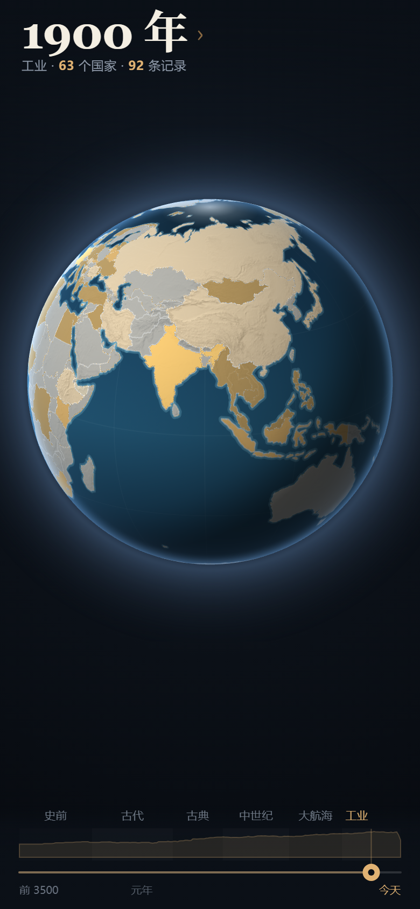
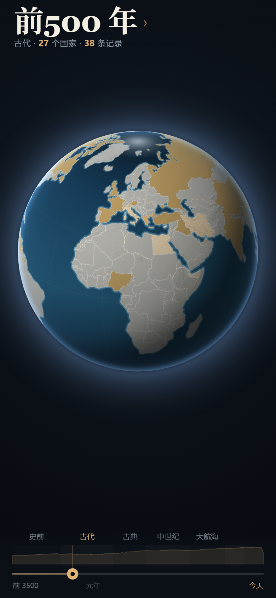

# 地球仪 · 时空坐标

一颗地球，一条时间轴。拖动时间轴走进任何一个年代，地图会跟着变亮变暗：有记录的地方是金色，只有纪年的地方是暖灰，没记录的地方退成冷灰。点国家看它在这个年代发生了什么，点年份看这一年整个世界。

- 打开即用：<https://lllliam.github.io/spacetime-globe/>
- iPhone / Android：浏览器打开 → 分享 →「添加到主屏幕」，之后全屏运行、断网也能用。






## v1.0 做了什么

上一版（v0.1）只能算一张会转的图：渲染出来的半球和点击命中的半球对不上（WebGL 变换矩阵写错了符号），所以点国家经常点不动、点错国家；拖动方向是反的；缩放糊成一片；手机上 30 fps 上下、一直空转耗电；Service Worker 缓存住旧页面再也不更新。这一版把这些全部换掉：

**渲染**

- 球体改为 **WebGL 贴图球**（正交投影 + 片元光照 + 边缘大气），2048×1024 地表贴图，60 fps；没有 WebGL 时自动退回 Canvas2D 软件渲染（同一套数学，画质降低但功能不缺）。
- 贴图用 Canvas2D 一次性画出来：海深渐变、大陆架晕边、地形浮雕、国界线、经纬网、极冠。点击命中用同一套投影反解，**拾取与画面严格一致**（`docs/` 里的截图就是这么验的）。
- 光照方向固定在世界坐标，转动时昼夜分界线会跟着走；夜面压暗但不会死黑。
- 放大范围 1×–6×，双指/滚轮以指尖为中心推进；支持双击放大。贴图带 mipmap + 各向异性过滤，放大后依旧干净。

**交互**

- 拖动跟手（含水平/垂直惯性），点按 < 10px、< 320ms 才算点击。
- 时间轴：任意位置按下即定位，章节带按内容量分段并限幅，数据密度曲线显示哪一段人类记录最密；当前章节标签始终可见。
- 底部抽屉：国家名 + 当年条目，当年没记录就退到「最近的条目」，并注明原因。
- **这一年 · 世界**：点顶部年份，全屏列出该年世界各地发生的事，按大区分组、按接近程度排序，点任意一条直接跳去那个国家。
- 键盘：← → 逐年，Shift+← → 二十年，Home/End 首尾，+/- 缩放，Esc 关闭。

**性能与离线**

- 空闲即停：打开后自转 22 秒，之后彻底静止（不再占用 rAF），任何交互立刻唤醒。
- Service Worker 改为 **index.html 网络优先**（改完部署，下次打开就是新版）、静态资源缓存优先（断网可用）。

## 数据

- 年表 1512 条、105 个地区分组（含宗教与世界性事件），每条的 `zh/en/es` 名称、起止年、类型、来源链接都在 `data/atlas.json` 里。
- 世界轮廓：Natural Earth（公有领域），1000×500 SVG path，177 块。
- 地形浮雕：内嵌灰度高程图（1536×768 JPEG）。
- 边界用的是**现代国界**：看前 500 年的「中国」时，高亮的是今天的国境范围，这是当前数据集的取舍，不是渲染错误。

## 开发

```bash
npm run build      # src/ + data/ → 单文件 index.html
npm run serve      # http://localhost:8080 本地预览
npm run verify     # 无头浏览器回归：点选/拖动/缩放/时间轴/全景列表
```

- `src/shell.html`、`src/app.css`、`src/app.js` 是源码；`build.mjs` 把样式、脚本、年表、浮雕全部内联进 `index.html`，构建时会校验年表字段（地区是否存在、起止年是否合法等），坏数据直接构建失败。
- **不要直接改 `index.html`**，它是产物；改完源码 `npm run build` 再提交。GitHub Pages 会自动更新首页。

## 已知限制（下一版）

- 没有历史政权边界：Cliopatria 那套数据要几 MB，还要另一套拾取逻辑，等有精力再说。
- 事件点位没有画在球面上（目前只有国家填色 + 列表），下一步可以做「这一年发生的 N 件事」的小圆点。
- 条目只有起止年，没有月度精度（数据结构留了 `sm/sd/em/ed` 字段）。
- 深色底 + 金色高对比在强光下偏暗，户外可读性还能再调。
