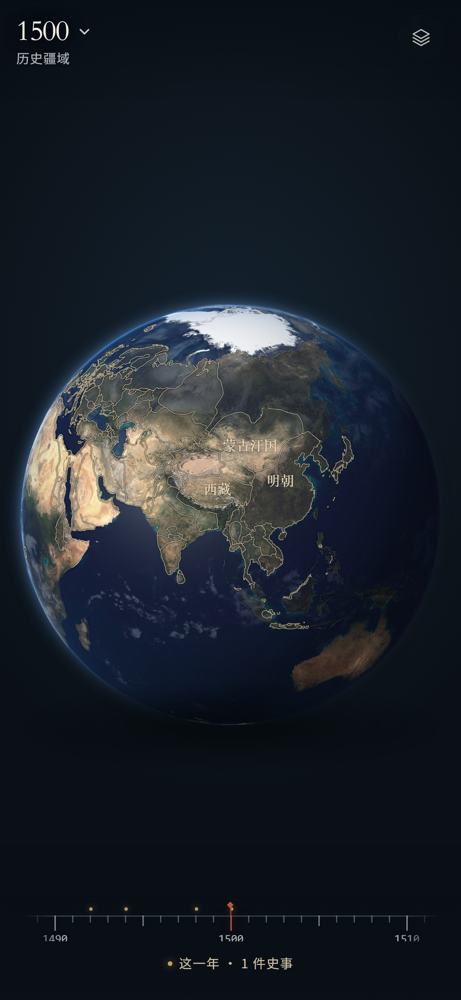
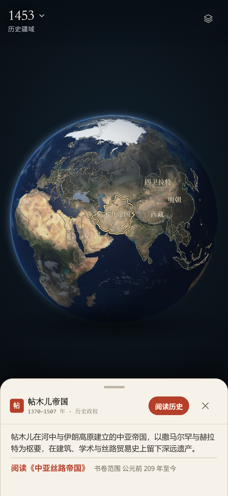
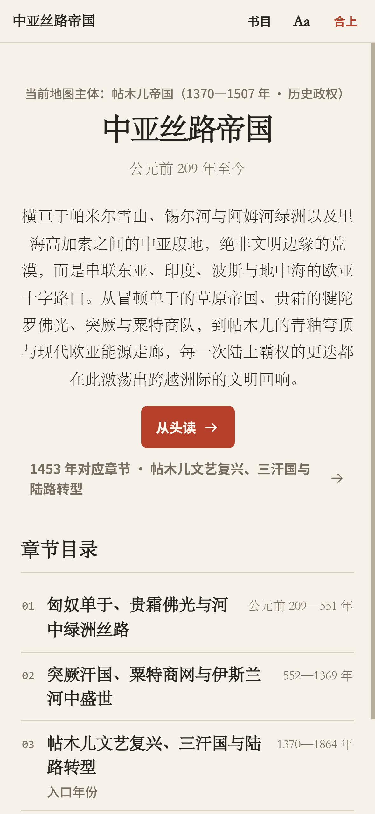
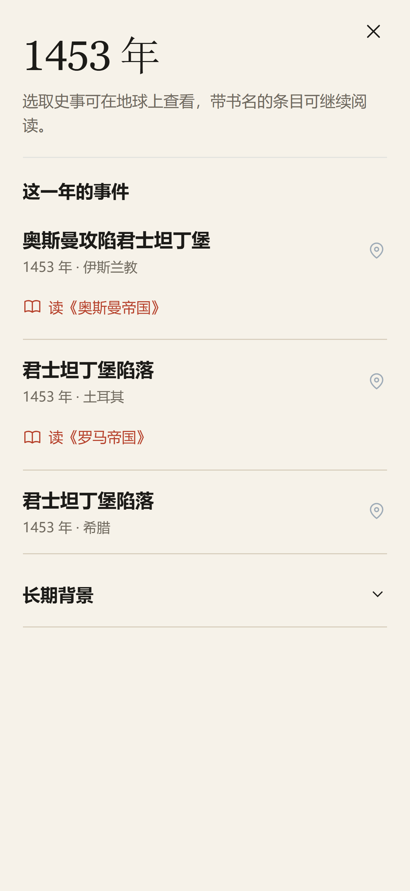
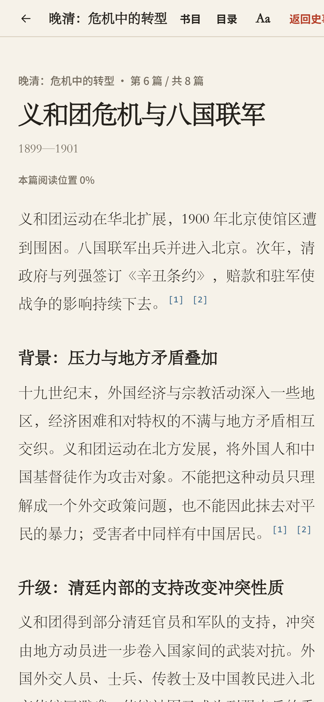
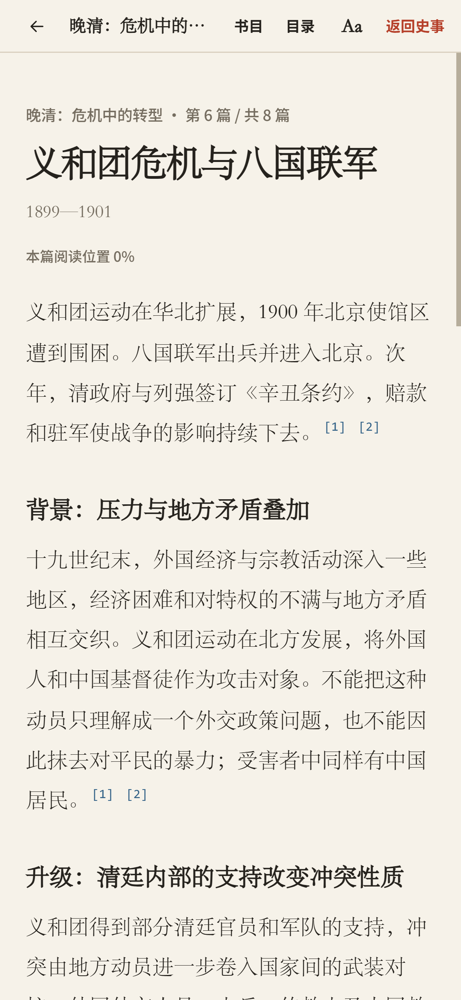
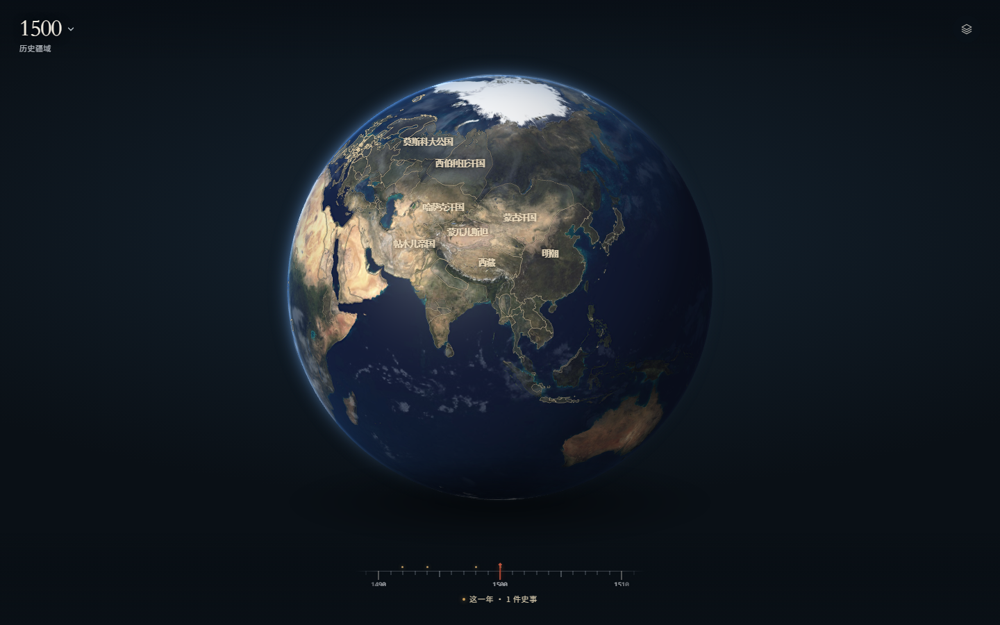

# 全局产品质量治理与书卷清查报告

实施基线为 `333062d`（`1.0.0-rc.1`，版本标识保持不变）。本轮依据产品负责人在桌面端、移动端及跨地区探索中的实际使用反馈，按「定位根因 → 全局排查 → 源数据与公共逻辑治理 → 构建期及浏览器防回归 → 实拍复验」流程完成五类系统性修复，并对全部 57 卷历史书卷开展只读结构清查（不重写书卷正文、不擅自恢复 Phase 07）。

> **真机验收状态**：所有桌面、移动端、离线与安全区行为均在无头 Edge CDP（WebGL 与 Canvas2D 双路径）完成实测与截图核对；**iPhone 真机 Safari 及主屏幕 PWA 实机体验仍待产品负责人复核。**

---

## 一、五类系统性问题治理总表

| 编号 | 根本原因 | 影响范围 | 全局排查方法 | 统一修复规则 | 已核实并修复样本数 | 仍待核定／未完成范围及不强修原因 | 防回归机制与通过状态 |
| --- | --- | --- | --- | --- | --- | --- | --- |
| **P1-1 · 历史主体与编辑书卷身份混淆** | `syncSheetIdentity()`（`src/app.js`）与 `subjectSheetMarkup()`（`src/subject-reader.js`）优先用 `book.title`、`subjectYears(book)` 覆写选中底图实体的名称与年代；另有 9 条同名异物（或年代完全不相交）的主入口误绑 | 全库 471 条原底图入口中有 446 条「主入口书卷名≠实体名」（如 1453 帖木儿帝国显示《中亚丝路帝国》公元前 209 年至今、前 221 秦国显示《春秋与战国》、哈萨克斯坦显示《中亚丝路帝国》等）；9 条零重叠误绑 | 扫描全部 1,604 条 Cliopatria 政权（1,552 规范名＋50 关系＋2 未译）、177 个现代国家、471 条绑定，与 `data/polity.bin` 几何时间交集逐条比对 | UI 摘要固定展示规范主体名及已核身份/年代，另设独立「阅读《书卷》 · 书卷范围 …」入口；同名（如《明朝》）不重复展示；进入多政权书卷展示当前主体来源语境；删除零重叠误绑；未入台账者诚实标注「存续年代待核（底图记录 …）」 | 清理 9 条零重叠误绑（`471 → 462`）；在 `data/history/subjects.json` 建档并核定 47 条重点政权与现代国家（全库台账增至 50 条：45 政权＋3 国家＋1 区域＋1 文明，其中 47 条 `checked`、2 条 `unreviewed`、1 条 `legacy`） | 其余 251 个已绑定但未入精细台账的底图政权暂不杜撰生卒年，界面统一显式展示「存续年代待核（底图记录 …）」与 460 条待逐条审校提示 | `tools/history-model.mjs` 在构建期拒绝 `polity` 入口范围与底图 `data/polity.bin` 零重叠绑定；`verify-ui.js` 与 `verify-product.js` 覆盖帖木儿帝国、秦国、哈萨克斯坦、明朝、中国及未入台账样本 |
| **P1-2 · 历史事件身份割裂与重复** | `data/world.json`（1,512 条）按现代国家/地区/宗教分类拆录同一历史事件，游标角标、`concreteEventStarts()` 与「这一年」列表直接遍历原始数组 | 扫描发现 56 组共用外链 URL、34 组起止与中文名完全一致、8 组同年月日重合事件（代表样本：1453 君士坦丁堡陷落拆成 3 条、1500 卡布拉尔拆成 2 条、冷战拆成 3 条） | 全局比对 1,512 条事件的 `start/end/sm/sd/em/ed`、规范化中文名、`source` URL 与相似标题 | 新增唯一归并清单 `data/history/event-identities.json`，在 `initWorld()` 生成 `canonicalEntries` 与 `canonicalEventById` 索引，列表/角标/计数单源使用规范条目，合并地区列表、双书卷阅读按钮（如《罗马帝国》与《奥斯曼帝国》）与来源，同时兼容旧成员 ID 定位与观察返回 | 确认合并 **35 组 / 72 条原始记录 → 35 条规范史事**（消除 37 条重复卡片，含 1453 君士坦丁堡陷落 3→1、1500 卡布拉尔 2→1、冷战 3→1 等） | 保留 **13 组 / 32 条 `pendingCandidates`**（如阿拉伯黎凡特政治统治 vs 伊斯兰化、一战各战役与国别体验、波罗的海三国不同结束年），因历史分期或视角不同不强制合并 | `tools/history-model.mjs` 禁止跨组重复归并与遗漏成员，并对未收录进清单的新增「同日起止＋同规范中文名＋同源 URL」重复报错；`verify-ui.js` 验证 1453/1500/1960 去重及双书卷跳转 |
| **P2-1 · 移动端顶栏响应溢出** | `src/reading.css` `#book` 使用单向网格声明 `grid-template-rows: auto minmax(0, 1fr)` 但缺少 `grid-template-columns: minmax(0, 1fr); width: 100%`，当 `#book-bar`（`晚清：危机中的转型` 9 字等长标题）无界撑宽网格隐式列至 `419px` 时，右侧「返回史事」被裁出 `393px` 视口 | 在所有窄屏（`320px`–`430px`）阅读长标题书卷/专题或触发「返回史事」与大字号时发生顶栏溢出 | 全局排查 `src/reading.css` 与 `src/app.css` 中的固定定位全屏容器（`#book`、`#book-bar`、`#event-map-top`、`#sheet`、`#overlay`），在 `320×568`、`393×852`、`430×932`、`844×390` 及 `extra` 字号下实测滚动宽度与控件右边界 | 为 `#book` 增加 `grid-template-columns: minmax(0, 1fr); width: 100%; max-width: 100%`；收敛 `< 440px` 下 `#book-bar` 横向内边距同时严格保留 `min-width: 44px; min-height: 44px` 触控区，并为 `#reading-book-name` 与 `#event-map-top` 添加截断与 `title` 提示；完整保留 `333062d` 的上下安全区独立管理机制 | 修复 `#book`、`#book-bar`、`#book-body` 与 `#event-map-top` 全局样式，并通过 3 档窄屏及超大字号实测 | 实际 iPhone Safari / 主屏幕 PWA 在真实机上切换动态字体与长标题仍待产品负责人复核 | `verify-mobile.js`（393×852 / 320×568）与 `verify-ui.js`（393 / 320 / 430）在 `extra` 字号下断言 `scrollWidth <= clientWidth` 及全部按钮 `right <= innerWidth` 与 `≥ 44px` |
| **P2-2 · 时间轴视觉可读性偏弱** | `src/chrome.css` 中 `#vernier-track` 静止透明度为 `0.58`，叠加半透明年份/刻度文字与细刻度线后，实效不透明度降至 `0.21–0.34`，在深空底色上难以辨认 | 首页与探索态全部桌面及移动端视口的底部时间游标 | 逐项核查 `#vernier` 遮罩渐变、刻度线色彩与粗细、年份标注、`has-event` 圆点及 `#year-era` 的混合不透明度 | 克制提高基准可读性：`#vernier-track` 静止透明度由 `0.58` 提至 `0.84`；扩宽边缘柔和遮罩至 `10%..90%`；加强大小刻度线宽与灰度梯度；为年份标签增加文字阴影并强化 `#year-era`、`has-event` 圆点及顶部暗角对比度 | 全局统一修复时间游标样式 | 深浅环境光线下真机观感待产品负责人确认 | 已通过 `verify-home.js`、`verify-mobile.js`、`verify-ui.js` 与 393px/1440px 截图视觉复核 |
| **P2-3 · 探索冷启动 1x 可发现性** | `drawVector()` 在 `state.zoom === 1 && !state.focus && !hasScenePolities` 时将最大标签数硬锁为 `0`，且使用固定 `3000px` 屏幕面积阈值与 `draw()` 跳过 `globeHudBounds()`，导致冷启动完全零地名 | Explore 默认 `1x` 缩放视口（桌面及手机所有地区） | 检查 `drawVector()` 与 `draw()` 的投影缩放公式，消除固定像素面积假设，并验证手机/桌面不同视野密度 | 以球半径 `Rz * Rz` 为尺度基准替换固定面积阈值；在 `chrome.labels && !chrome.natural` 下默认展示克制数量的焦点/大国名标签（移动端最多 5 个、桌面最多 8 个），`draw()` 始终传入 `globeHudBounds()` 自动避让顶部年份、图层开关与底部游标 | 统一修复球面地名筛选与 HUD 避让逻辑 | 多地区旋转连续帧下真机阅读感受待产品负责人确认 | `verify-ui.js` 断言 1500 年 `1x` 缩放展示 `2..5` 个主要政权名（实际实测：蒙古汗国、明朝、哈萨克汗国、西藏）且不侵入上下 HUD 安全带 |

---

## 二、改造前后视觉实拍对照

### 1. 1500 年冷启动（默认 1x 地名可发现性与时间轴对比度）

| 改造前（无政权标签、游标刻度偏暗） | 改造后（克制地名引导＋清晰刻度与单一合并史事计数） |
| --- | --- |
|  |  |

### 2. 1453 年帖木儿帝国（主体身份与书卷入口分离）

| 1453 选中摘要（显示「帖木儿帝国 1370—1507 年 · 历史政权」与独立《中亚丝路帝国》入口） | 打开书卷扉页（保留来源主体语境并推荐 1453 章节） |
| --- | --- |
|  |  |

### 3. 1453 年史事列表（君士坦丁堡陷落去重与双书卷保留）

| 改造前（同一天重复 3 条） | 改造后（合并为 1 条并保留双书卷入口与多地区汇总） |
| --- | --- |
|  |  |

### 4. 393px 移动端《义和团危机与八国联军》阅读顶栏 + 1440px 桌面端

| 改造前 393px（右侧「返回史事」被裁出屏幕） | 改造后 393px（全按钮完整居中截断） | 改造后 1440px 桌面端（7–8 个克制标签＋清晰刻度） |
| --- | --- | --- |
|  |  |  |

---

## 三、全库 57 卷历史书卷只读清查（对标《明朝》）

对照已通过专项验收的《明朝》标杆书卷（`20` 章、总计 `13,340` 字、均章 `667` 字、`98` 条来源、`10` 处正文场景引用／`8` 个可用现场、`5` 条旁注、`14` 条跨卷关联、`introduction/narrative/thematic/epilogue` 多体裁章节结构），其余 56 卷目前仅作结构性统计与差距标注（本轮未修改任何正文措辞）：

| 维度 | 《明朝》标杆 | 其余 56 卷现状统计 | 主要结构差距 |
| --- | --- | --- | --- |
| **章节体裁与数量** | 20 章（序论＋叙事＋专题＋尾声） | 共 223 章，平均 3.98 章／卷；**54 卷 ≤ 4 章**（五代十国、隋朝、秦朝各 3 章，宋朝与清朝各 5 章） | 绝大多数书卷仍处于概览型 3–4 章结构，缺乏专题切片与结构性后记 |
| **正文体量与展开深度** | 13,340 字 | 非明朝均卷仅 **3,056 字**（虽单章均值 767 字，最低如《五代十国》1,898 字、《隋朝》1,939 字、《中华人民共和国》2,246 字、《秦朝》2,255 字、《唐朝》2,405 字） | 主题跨度数百年至两千年却浓缩在三千字上下，制度机制与民间生活证据偏薄 |
| **历史现场联动** | 10 处章节引用（8 个可用场景） | **24 卷拥有 0 个历史现场**（含《中华人民共和国》《五代十国》《春秋与战国》《中亚丝路帝国》《中美洲古文明》等）；每卷均仅 1 组固定旁注模型 | 大量关键地区只能纯文字阅读，无法「在地球上观察」空间过程 |
| **史料来源厚度** | 98 条独立出处 | **17 卷来源数 ≤ 3 条**（《夏商与西周》《蒙古帝国》《日本》各仅 1 条，《阿拉伯帝国》《古希腊与马其顿帝国》《中亚丝路帝国》等 10 卷各仅 2 条） | 单卷对应多政权（最高如《中亚丝路帝国》承接 18 个底图政权、《春秋与战国》16 个）却极度缺少一手/学术分期文献支撑 |
| **审校与 Phase 07** | 独立台账逐章核验通过（Phase 08） | 全库 5,576 项仅处置 387 项，**106 项一级高风险候选待审**；多卷仍保留概略化修辞痕迹 | 正式 `1.0.0` 仍需在后续专项批次中逐卷恢复 Phase 07 审校并按《明朝》标准扩充 |

> **后续内容扩展建议优先级**：优先围绕高频热点及多政权共用书卷（《中亚丝路帝国》《阿拉伯帝国》《古希腊与马其顿帝国》《日本：从飞鸟平安到现代转型》《蒙古帝国》《中华人民共和国》）补充来源文献与历史现场，并恢复 Phase 07 一级候选审校，然后再推进篇幅扩充。
